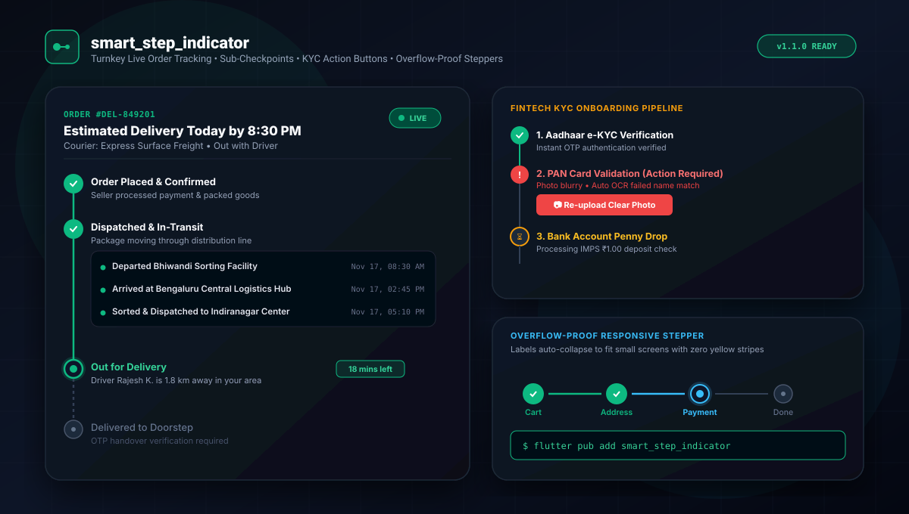

# smart_step_indicator

<p align="center">
  <a href="https://pub.dev/packages/smart_step_indicator"></a>
  <a href="https://pub.dev/packages/smart_step_indicator/score"></a>
  <a href="https://govindtank.github.io/smart_step_indicator/"></a>
  <a href="https://github.com/govindtank/smart_step_indicator"></a>
  <a href="https://github.com/govindtank/smart_step_indicator/blob/main/LICENSE"></a>
  <a href="https://buymeacoffee.com/govindtanko"></a>
  <a href="https://github.com/sponsors/govindtank"></a>
</p>

<p align="center">
  <strong>Responsive, overflow-proof step indicator and turnkey order tracking timeline for Flutter.</strong><br>
  Sub-checkpoints, KYC action buttons, live delivery ETA badges, and auto-collapsing labels that eliminate screen overflow exceptions.
</p>

---

<p align="center">
  <a href="https://govindtank.github.io/smart_step_indicator/">
    
  </a>
</p>

---

## ⚡ Key Features

| Feature | Description | Real-World Use Case |
|---|---|---|
| **Turnkey `OrderTrackingTimeline`** | Pre-built live delivery timeline with order ID, live ETA badge, and status header | E-Commerce (Amazon/Flipkart), Food Delivery (Swiggy/Zomato) |
| **Hierarchical Sub-Checkpoints** | Nested sub-events under milestones with scan timestamps (`StepSubEvent`) | Freight & logistics tracking scans |
| **KYC Action Required States** | `StepStatus.actionRequired` with interactive CTA button (`Re-upload Photo`) | Fintech bank account onboarding & identity checks |
| **In-Review Verification** | `StepStatus.inReview` with visual verification indicator | Manual audit & IMPS penny-drop verification |
| **Zero-Overflow Auto Collapse** | Automatically collapses labels to compact dots on narrow screens | Eliminates yellow/black horizontal overflow errors |
| **Pulsing Radar Node** | Subtle breathing glow effect on active milestones | Highlights current in-progress state |

---

## 🚀 Quick Usage

### 1. E-Commerce & Food Delivery Tracking (`OrderTrackingTimeline`)

```dart
OrderTrackingTimeline(
  orderId: 'DEL-849201',
  etaTitle: 'Estimated Delivery Today by 8:30 PM',
  etaSubtitle: 'Courier: Express Surface Freight • Out with Driver',
  currentStep: 2,
  steps: const [
    SmartStep(
      title: 'Order Placed & Confirmed',
      subtitle: 'Seller processed payment & packed parcel',
    ),
    SmartStep(
      title: 'Dispatched & In-Transit',
      subtitle: 'Package moving through distribution line',
      subEvents: [
        StepSubEvent(
          title: 'Departed Bhiwandi Sorting Facility',
          timestamp: 'Nov 17, 08:30 AM',
        ),
        StepSubEvent(
          title: 'Arrived at Bengaluru Central Hub',
          timestamp: 'Nov 17, 02:45 PM',
        ),
      ],
    ),
    SmartStep(
      title: 'Out for Delivery',
      subtitle: 'Driver Rajesh K. is 1.8 km away',
      etaBadge: '18 mins left',
    ),
    SmartStep(
      title: 'Delivered',
      subtitle: 'OTP handover verification required',
    ),
  ],
)
```

---

### 2. Fintech KYC Verification Pipeline

```dart
OrderTrackingTimeline(
  orderId: 'KYC-9421',
  etaTitle: 'KYC Onboarding Pipeline',
  currentStep: 1,
  steps: [
    const SmartStep(
      title: 'Aadhaar e-KYC Verification',
      subtitle: 'Instant OTP verified via UIDAI',
      status: StepStatus.completed,
    ),
    SmartStep(
      title: 'PAN Card Validation',
      subtitle: 'Document photo blurry • Failed OCR',
      status: StepStatus.actionRequired,
      actionLabel: 'Re-upload Clear Photo',
      onActionPressed: () => launchDocumentCamera(),
    ),
    const SmartStep(
      title: 'Bank Account Penny Drop Check',
      subtitle: 'Verifying name match via IMPS ₹1.00',
      status: StepStatus.inReview,
    ),
  ],
)
```

---

### 3. Overflow-Proof Horizontal Stepper

```dart
SmartStepIndicator(
  currentStep: 1,
  onStepTapped: (index) => print('Tapped step: $index'),
  steps: const [
    SmartStep(title: 'Cart', subtitle: 'Review items'),
    SmartStep(title: 'Address', subtitle: 'Delivery address'),
    SmartStep(title: 'Payment', subtitle: 'Card / UPI'),
    SmartStep(title: 'Confirm', subtitle: 'Order complete'),
  ],
)
```

---

## 💖 Support the Project

If you find this project useful, consider supporting its active maintenance and future development:

<p align="left">
  <a href="https://buymeacoffee.com/govindtanko"></a>
  <a href="https://github.com/sponsors/govindtank"></a>
  <a href="https://www.patreon.com/govindtank"></a>
</p>

---

## 📄 License

This project is licensed under the Apache License 2.0 - see the [LICENSE](LICENSE) file for details.

*Maintained with ❤️ by [Govind Tank](https://github.com/govindtank).*
