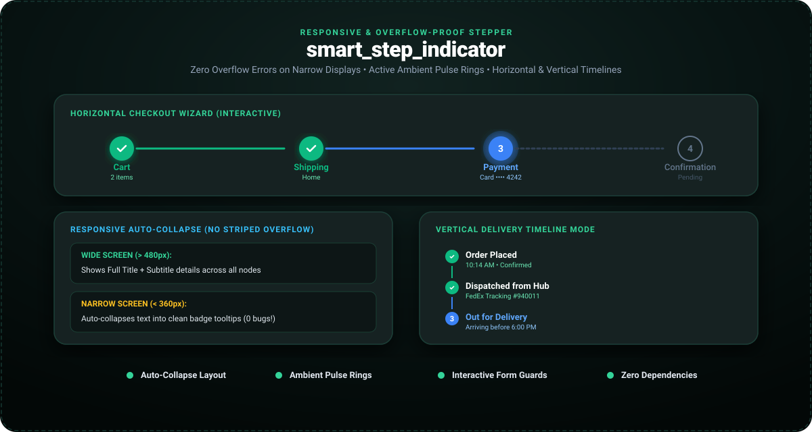

# smart_step_indicator

<p align="center">
  <a href="https://pub.dev/packages/smart_step_indicator"></a>
  <a href="https://pub.dev/packages/smart_step_indicator/score"></a>
  <a href="https://govindtank.github.io/smart_step_indicator/"></a>
  <a href="https://github.com/govindtank/smart_step_indicator"></a>
  <a href="https://github.com/govindtank/smart_step_indicator/blob/main/LICENSE"></a>
  <a href="https://buymeacoffee.com/govindtanko"></a>
  <a href="https://github.com/sponsors/govindtank"></a>
</p>

<p align="center">
  <strong>Responsive, overflow-proof step indicator and timeline stepper for Flutter.</strong><br>
  Intelligently collapses labels to eliminate yellow/black horizontal overflow errors on narrow screens, with ambient pulse rings and animated checkmarks.
</p>

---

<p align="center">
  <a href="https://govindtank.github.io/smart_step_indicator/">
    
  </a>
</p>

<p align="center">
  🎮 <strong><a href="https://govindtank.github.io/smart_step_indicator/">Launch Live In-Browser Interactive Demo</a></strong>
</p>

---

## ✨ Features

- **🛡️ 100% Overflow-Proof:** Automatically measures available screen width. If step labels would cause horizontal overflow on mobile screens or split-view devices, it dynamically collapses labels into clean badge tooltips.
- **💫 Status-Driven Morphing:** Supports `completed` (spring checkmark), `active` (ambient breathing pulse ring), `pending`, `error` (alert badge), and `disabled` states.
- **🔄 Dual Orientation:** Seamlessly switches between horizontal checkout wizards and vertical delivery tracking timelines.
- **👆 Interactive Navigation:** Tap to navigate between steps with optional validation guards (`canChangeStep: (from, to) => bool`).
- **📳 Tactile Haptic Feedback:** Triggers subtle haptic feedback on step selection.
- **📦 Zero External Dependencies:** Pure Flutter implementation. Full compatibility across Android, iOS, Web, macOS, Windows, and Linux.

---

## 🚀 Getting Started

Add `smart_step_indicator` to your `pubspec.yaml`:

```yaml
dependencies:
  smart_step_indicator: ^1.0.1
```

Import the package:

```dart
import 'package:smart_step_indicator/smart_step_indicator.dart';
```

---

## 💡 Usage

### 1. Interactive Form Stepper

```dart
SmartStepIndicator(
  currentStep: currentStep,
  onStepTapped: (index) => setState(() => currentStep = index),
  steps: const [
    SmartStep(title: 'Account', subtitle: 'Credentials'),
    SmartStep(title: 'Profile', subtitle: 'Personal info'),
    SmartStep(title: 'Security', subtitle: '2FA Setup'),
    SmartStep(title: 'Confirm', subtitle: 'Review'),
  ],
)
```

### 2. Vertical Order Timeline

```dart
SmartStepIndicator(
  axis: Axis.vertical,
  currentStep: 2,
  steps: const [
    SmartStep(title: 'Order Placed', subtitle: '10:14 AM', icon: Icons.receipt_long),
    SmartStep(title: 'Dispatched', subtitle: 'FedEx #94001', icon: Icons.local_shipping),
    SmartStep(title: 'Out for Delivery', subtitle: 'Arriving today', icon: Icons.delivery_dining),
    SmartStep(title: 'Delivered', subtitle: 'Pending', icon: Icons.check_circle_outline),
  ],
)
```

---

## ⚙️ Configuration

| Property | Type | Default | Description |
| :--- | :--- | :--- | :--- |
| `steps` | `List<SmartStep>` | *required* | The list of step data definitions. |
| `currentStep` | `int` | `0` | Zero-based index of the currently active step. |
| `axis` | `Axis` | `.horizontal` | Orientation: `.horizontal` or `.vertical`. |
| `onStepTapped` | `ValueChanged<int>?` | `null` | Callback fired when an enabled step is clicked. |
| `canChangeStep` | `bool Function(int, int)?` | `null` | Predicate guard before allowing navigation. |
| `activeColor` | `Color` | `Color(0xFF3B82F6)` | Color for active step and ambient glow ring. |
| `completedColor` | `Color` | `Color(0xFF10B981)` | Color for completed checkmarks and lines. |
| `errorColor` | `Color` | `Color(0xFFEF4444)` | Color for error status steps. |
| `circleSize` | `double` | `36.0` | Node diameter in logical pixels. |
| `enablePulse` | `bool` | `true` | Plays ambient pulsing ring around the active step. |
| `responsiveMode` | `StepResponsiveMode` | `.auto` | `.auto`, `.alwaysFull`, or `.compact`. |

---

## 🔗 Related Packages by Author

* **[android_island_bar](https://pub.dev/packages/android_island_bar)** — Universal cross-platform island overlay with hardware cutout snapping.
* **[flutter_sonner](https://pub.dev/packages/flutter_sonner)** — Opinionated stacked action toast & notification HUD inspired by Sonner.
* **[flutter_smooth_marquee](https://pub.dev/packages/flutter_smooth_marquee)** — Performance-first marquee & auto-scrolling ticker with zero-waste overflow detection.
* **[adaptive_context_menu](https://pub.dev/packages/adaptive_context_menu)** — Adaptive context menu with 3D pop preview and real-time backdrop blur.
* **[spatial_card](https://pub.dev/packages/spatial_card)** — 3D tactile interactive cards & multi-plane parallax surfaces.

---

## 💖 Support the Project

If you find this project useful, consider supporting its active maintenance and future development:

<p align="left">
  <a href="https://buymeacoffee.com/govindtanko"></a>
  <a href="https://github.com/sponsors/govindtank"></a>
  <a href="https://www.patreon.com/govindtank"></a>
</p>

---

## 📄 License

This project is licensed under the Apache License 2.0 - see the [LICENSE](LICENSE) file for details.

*Maintained with ❤️ by [Govind Tank](https://github.com/govindtank).*
